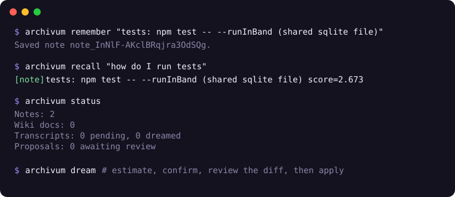
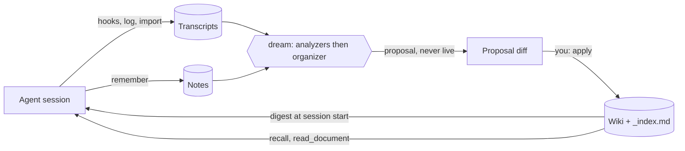

<div align="center">

<picture>
  <source media="(prefers-color-scheme: dark)" srcset="docs/assets/logo-dark.svg">
  
</picture>

# Archivum

**Long-term memory for AI agents. Plain files on your machine, and you review every change.**

<p align="center">
  <a href="https://www.npmjs.com/package/archivums"></a>
  <a href="https://github.com/tryarchivum/archivum/actions/workflows/ci.yml"></a>
  <a href="LICENSE.md"></a>
  <a href="#install"></a>
  <a href="#use-it-from-your-agent"></a>
  <a href="packages/cli/package.json"></a>
</p>

[Website](https://tryarchivum.com) · [Try it in the browser](https://tryarchivum.com/try/) · [Docs](https://tryarchivum.com/docs/) · [npm](https://www.npmjs.com/package/archivums) · [X](https://x.com/Use_Archivum)

```sh
npx archivums init
```

```
0xda4283f14b487034b90d865aac489994f2c680c4
```

</div>

<p align="center"></p>

---

> [!NOTE]
> Beta. Everything marked "verified" below was run. [What was not run](#status-and-limits) is listed at the end, in plain words.

## Why

Agents are sharp inside a session and forget everything between sessions. Archivum gives them a notebook they keep: short notes, session transcripts and a small markdown wiki, stored as ordinary files in `~/.archivum`. Nothing runs in the background and nothing leaves your machine, except the model calls of a dream you start yourself.

## What you get

| Piece | Command | Who uses it |
| --- | --- | --- |
| CLI | `archivum remember`, `recall`, `status`, `dream`, `apply`, ... (18 commands) | you, in a terminal |
| MCP server | `archivum mcp` (17 tools and a context resource) | your agent: Claude Code, Codex, Hermes, any MCP client |
| Claude Code hooks | `archivum hook session-start`, `user-prompt`, `stop` | Claude Code, set up by `init` |

One npm package, **`archivums`**. It installs the command **`archivum`**. The core library is inside it, so there is nothing else to install.

## Install

```sh
npx archivums init
```

`init` finds Claude Code, Codex, Hermes, Cursor and Claude Desktop on your machine and sets each one up. Add `--dry-run` to see what it would change first; files it edits are backed up, and a config file it cannot parse is left alone. Requires Node 22+.

If `npm install -g archivums` was run first, Claude Code, Codex and Hermes are registered with the installed `archivum mcp`, which starts about ten times faster than `npx` (0.3 s against 2.8 to 3.7 s, measured); without it they use `npx -y archivums mcp`.

Pick clients yourself with `--claude-code`, `--codex`, `--hermes`, `--cursor`, `--claude-desktop`, or `--all`.

MCP server only, for any client:

```sh
claude mcp add archivum -- npx -y archivums mcp
codex mcp add archivum -- npx -y archivums mcp
```

Optional, for Claude Code: look memory up before every prompt, and hand the agent the few notes that match (nothing when nothing matches).

```sh
npm install -g archivums
archivum init --claude-code --prompt-recall
```

This one needs the installed command on your PATH, because it runs before every prompt and `npx` took 2.7 to 4.4 seconds per call when measured (the installed command: 0.2 to 0.4 s). It exists because, in our tests, agents did not call `recall` on their own.

## How it works



| Layer | What it is | Who writes it |
| --- | --- | --- |
| **Transcripts** | append-only session logs, secrets redacted before they reach disk | Claude Code hooks, `archivum log`, `archivum import omp`, the `save_transcript` tool |
| **Notes** | short facts: a command, a decision, a gotcha | your agent, through `remember` and `update_note` |
| **Wiki** | a few linked markdown files plus an `_index.md`; every write is a version | the dream, after you approve |
| **Context** | a short digest injected at session start | derived from the wiki index |

Search is BM25 over notes and wiki pages plus the wiki's own links. No embeddings, no vector database, nothing to host.

## Dreaming

A **dream** reads pending transcripts and notes with hindsight, checks the wiki against them, corrects stale facts, merges duplicates and links related pages. It writes a **proposal**, never the live wiki. You read the diff and decide.

```sh
archivum diff        # what would change
archivum apply       # accept it (every write is a version you can restore)
archivum reject      # or throw it away
```

Two ways to run one:

- **With your own key.** `export ARCHIVUM_LLM_API_KEY=...` (or `ANTHROPIC_API_KEY` / `OPENAI_API_KEY`), then `archivum dream`. It prints a token estimate and asks before spending. Anything OpenAI-compatible works (`ARCHIVUM_LLM_PROVIDER=openai`, `ARCHIVUM_LLM_BASE_URL=...`), including local routers.
- **With no key.** Ask the agent you already use to dream. It calls the MCP tools `dream_prepare` and `dream_submit`, does the thinking with its own model on your existing plan, and the result is the same kind of proposal. Inputs are capped (120,000 characters by default) because they travel through the agent's context. Verified with a scripted MCP client and unit tests; quality with a real subscription agent is not measured yet.

## Use it from your agent

Archivum is an MCP server over stdio. The 17 tools: `remember`, `update_note`, `recall`, `forget`, `context`, `list_notes`, `save_transcript`, `read_document`, `search_documents`, `list_documents`, `related_documents`, `document_history`, `memory_status`, `list_proposals`, `show_proposal`, `dream_prepare`, `dream_submit`, plus the resource `archivum://context`. Duplicate notes are flagged, and memory text is always returned as data, never as instructions.

| Client | Status |
| --- | --- |
| Codex | MCP works. Codex used Archivum on its own only after `archivum init --codex` added a short block to the project's `AGENTS.md`. |
| Hermes | MCP lists all 17 tools. With the prompt-recall hook, an agent given no tools answered 3 of 3 stored facts; without it, 0 of 3. |
| Claude desktop app | The tools load and `save_transcript` worked in a real chat. The app preferred its built-in memory for saving facts, so ask for Archivum explicitly. |
| Claude Code (CLI) | MCP and hooks follow the documented formats. **Not yet run in a real Claude Code session.** |
| omp | Verified with the official MCP SDK client and with omp itself. |
| Cursor | Plugin manifest only, not tested. Add the server to `.cursor/mcp.json`. |
| ChatGPT | Not supported. It connects to remote HTTPS servers only; Archivum is a local stdio server. |

Skill and plugin files live here too: `skills/archivum/SKILL.md` (when to recall, what to remember, what never to save), `.claude-plugin/`, `.codex-plugin/` and `.cursor-plugin/`. The manifests follow the public formats and have not been installed in those clients yet.

## Does it actually help?

We measured it, and the result is mixed in an honest way. Synthetic scenarios, answers graded by regex, the same model answering with different contexts:

| Scenario | No memory | Append-only notes + BM25 | Dreamed wiki |
| --- | --- | --- | --- |
| 4 small projects (5 to 9 sessions each) | 0% | 83 to 100% | 100% |
| **scale**: 48 sessions, 31 distractors, facts that change 2 to 4 times (GPT-5.6 luna) | 0% | 38% | **94%** |
| **scale** (Gemini 3.8 flash) | 0% | 38% | **100%** |

- On small inputs the raw notes fit the search window, so **the dream only ties the naive baseline**. Its value there is structure and correctness marks.
- On a larger, noisy history, naive retrieval pulls stale or look-alike chunks and the dreamed wiki wins clearly.
- Caveats: synthetic data, one generator, one run each. This supports "the idea works under these conditions", not "it will help your project". Reproduce with `node eval/run.js --scenario all --qa`. The scale dream cost about 1M tokens (GPT) and 1.9M (Gemini).

## Everyday commands

```sh
archivum remember "text"            archivum recall "query" [--limit N] [--kind note|wiki] [--since DATE]
archivum context                    archivum status
archivum log                        # append a transcript from JSON (agents without hooks)
archivum import omp --all           # import omp sessions
archivum dream                      # estimate, confirm, then propose wiki changes
archivum dream --if-due --yes       # for cron: only when enough is pending, idle and past cooldown
archivum doctor [--json]            # read-only health check
archivum proposals                  archivum diff [id]
archivum apply [id] [--only P]        archivum reject [id]
archivum history [path]             archivum restore <path> [--version N]
archivum retention [--days 30]
archivum mcp                        archivum hook session-start|user-prompt|stop
```

Data lives in `~/.archivum` (or `$ARCHIVUM_HOME`), one folder per *space*; the space defaults to the current folder's name. Full reference: [packages/cli/README.md](packages/cli/README.md) and [tryarchivum.com/docs](https://tryarchivum.com/docs/).

Speed with 2000 notes and 400 wiki pages (Windows): `context` 146 ms, `status` 155 ms, `remember` 156 ms, `recall` 732 ms.

## Safety, briefly

- Secrets matching known patterns are scrubbed on every write (fuzz-tested). Pattern-based, so not a guarantee.
- Dream agents can read and edit documents only. They never write the live wiki; `apply` does, and only if the live file still matches what the dream started from.
- Transcripts and notes are treated as untrusted data, never as instructions. The eval includes an injection scenario that passed on GPT-5.6 luna.
- Threat model and how to report a problem: [SECURITY.md](SECURITY.md).

## FAQ

**Does anything leave my machine?** Only the model calls of a dream you start, to the provider you chose (or to your own agent, for the no-key route). There is no Archivum server, account or telemetry.

**Why not embeddings?** BM25 plus an index and links is enough for a small wiki, needs no model download and is easy to debug. It is a deliberate bet, and recall quality on very large stores is unproven.

**How much does a dream cost?** It prints an estimate first and refuses to exceed `--budget`. Roughly 20k to 30k tokens per short session; one noisy 48-session history was about 1M tokens. Use `--since` and `--max-inputs` for big backlogs.

**Can it ruin my notes?** A dream never edits the live wiki; you review a diff. Every applied write is a version you can `restore`.

**Is it ready for production?** No. It is a beta.

## Status and limits

Verified: the CLI and MCP server on Windows, macOS and Linux in CI (Node 22 and 24); the MCP server with the official SDK client; secret scrubbing and path handling under fuzzing; the dream with two real models on synthetic data; the hook and `init` behaviour from a clean install of the published package.

Not verified: the hooks inside a real Claude Code session; the Anthropic provider against the real API; most MCP clients; recall quality on very large stores; any claim that it helps on your own project. No external security review has been done.

## Roadmap

No dates, only order. Phases 1 and 2 are the plan, built from what fell short in real use. Later phases are direction: they are built only when real use asks for them, and nothing is called shipped until it has been run.

| Phase | Status | What it is |
|---|---|---|
| 1 | Shipped | Plain-file memory in four layers, search across sessions, facts updated in place, secrets scrubbed, dreams that only propose, dreaming through your own agent, one-command setup. Run in the real apps so far: Claude Code, Codex, Hermes and omp. |
| 2 | Next | **One memory across agents**, dependable in both directions, with a note of which agent wrote each fact (a fact saved in Claude Code has been recalled by a new Codex session, and a correction made in Codex was read by a fresh Claude Code session; one run each way). Also: a local **Memory Vault**, **dream quality** (a source for every claim, inferred lines marked, approve or reject page by page), **suggested memories** (an experiment), **project identity**, a **self-repairing install**. |
| 3 | Later | Personal memory shared across projects with clear scopes; export and import of a space; a tested compatibility table for every client. |
| 4 | Exploring | Memory you can verify: staleness checks against the repo, which notes were recalled and whether the answer held, time questions, embeddings only if keyword search proves to be the bottleneck. |
| 5 | Exploring | Memory for teams: a Git-backed shared wiki reviewed like pull requests, personal transcripts private by default. |
| 6 | Exploring | Memory in the background: scheduled dreams with a pre-approved budget, dreams on a local model, sub-agents that start from the project's memory. |
| 7 | Horizon | An open memory format: a written spec for the vault, a conformance check any client can run, memory that outlives vendors. |

Not planned: required accounts, a hosted copy of your memory, or dreams that apply themselves.

## Contributing, security, licence

- [CONTRIBUTING.md](CONTRIBUTING.md): how to run the tests and what a change must include.
- [SECURITY.md](SECURITY.md): threat model and where to report a vulnerability.
- [CHANGELOG.md](CHANGELOG.md): what changed in each release.
- [LICENSE.md](LICENSE.md): MIT.

```sh
git clone https://github.com/tryarchivum/archivum && cd archivum
npm install && npm test        # about 20 seconds, no network
```
